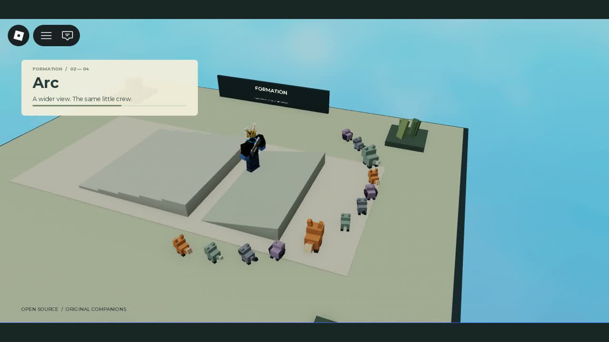

# Formation

Companion formations and motion for Roblox, with a Studio preview plugin and an original set of blocky sample pets.



Choose rows, an arc, or an orbit. Mix model sizes, preview ground and flying motion, then export the settings into your game. Formation renders cosmetic companions on the client; pet ownership, rewards, and gameplay stay in your own server code.

## Downloads

Get the files from [Releases](https://github.com/Ggaming5005/Formation/releases).

| File | Use |
| --- | --- |
| `FormationStudio.rbxm` | Studio preview plugin |
| `Formation.rbxm` | Runtime ModuleScript |
| `FormationDemo.rbxlx` | Standalone example place, including original models |
| `Formation-demo.mp4` | Short demonstration |

To install the plugin, insert `FormationStudio.rbxm` into a temporary place, select the inserted Script, and choose **Save as Local Plugin**. Delete that inserted copy afterward. Open **Plugins → Formation**. Preview the included companions or select your own Models, adjust the controls, and choose **Export configuration**. Export is undoable; temporary previews are removed when you stop or close the panel.

The exported `FormationConfig` ModuleScript contains `Settings` and `PetOptions`, including the Ground/Flying choice. Preview count and the sample size variation only affect the preview.

The plugin and runtime are separate downloads. Your published game only needs the runtime and your chosen assets.

The standalone demo runs for the play session and includes a course plus layout controls. To embed it temporarily in your own client test, call `require(game.ReplicatedStorage.FormationExamples.Demo).start(game.Players.LocalPlayer)` and retain the returned handle. Call `handle:Destroy()` to remove its companions, course, controls and update connection. Deleting the demo's launcher script alone does not perform that cleanup.

## Runtime

Insert `Formation.rbxm` into `ReplicatedStorage` and name it `Formation`. This example belongs in a LocalScript. Supply an existing Model with at least one BasePart as `template`.

```luau
local Formation = require(game.ReplicatedStorage.Formation)

local companions = Formation.new(character, {
	Settings = { Formation = "Arc", Spacing = 0.8, Distance = 6 },
	Exclude = { effectsFolder },
})
companions:Add("fox", template, { Scale = 0.8, Flying = false })
companions:Start()

companions:Configure({ Formation = "Orbit", OrbitSpeed = 0.2 })
companions:SetFlying(true)
companions:Remove("fox")
companions:Destroy()
```

To use the plugin's exported configuration:

```luau
local config = require(game.ReplicatedStorage.FormationConfig)
local companions = Formation.new(character, { Settings = config.Settings })
companions:Add("fox", template, config.PetOptions)
companions:Start()
```

`new(owner, config?)` accepts a Model, BasePart, or function returning a CFrame. A function can return `nil` to pause updates, for example between character spawns. Destroying an Instance owner destroys the controller. With a function owner, call `Destroy()` when your owning system ends. Call `Start()` again only after `Stop()` if you paused the automatic loop; both are idempotent. You can instead call `Step(dt)` from your own loop.

`Add(id, template, options?)` clones the template. IDs are unique nonempty strings, up to 128 bytes; one controller allows at most 200 companions. Models must be Archivable. Scale is relative to the template, between 0.1 and 10. Cloned parts are anchored with collision, touch and query disabled; cloned scripts are disabled. The source model is unchanged. Keep cosmetic templates free of gameplay code.

`Configure(changes)` validates and copies settings. `controller.Settings` is read-only; use `Configure` to change it. `GetStats()` returns `Count`, `Updates`, `Raycasts` and `LastStepMs`. The last value measures only that controller's latest executed update; it is not a game-wide performance benchmark.

## Settings

| Setting | Default | Purpose |
| --- | --- | --- |
| Formation | `"Rows"` | `Rows`, `Arc`, or `Orbit` |
| Columns | 5 | Models per row |
| Spacing / Distance | 0.65 / 5 | Footprint gap / initial follow distance, in studs |
| Responsiveness | 10 | Exponential smoothing response |
| GroundHeight | 0 | Extra ground clearance |
| FlightHeight / BobHeight / BobSpeed | 2.4 / 0.16 / 2.2 | Flight offset and subtle bob |
| OrbitSpeed | 0.22 | Radians per second |
| TeleportDistance | 70 | Owner jump that snaps companions into place |
| RayHeight / RayDepth / GroundInterval | 18 / 90 / 0.08 | Ground probe limits and interval |
| NearDistance / FarDistance | 90 / 220 | Camera distance thresholds |
| FarInterval / DistantInterval | 0.1 / 0.3 | Update intervals beyond those thresholds |

Unknown, nonfinite and out-of-range settings fail with a descriptive error. See [Settings.luau](src/Settings.luau) for exact bounds. Footprints are measured once when a companion is added; remove and re-add after changing its geometry.

## Scope

Ground companions follow sampled height with a softened surface tilt. They do not pathfind around walls or animate walking joints. Flight adds vertical bob; it is not a physics simulation. Layout spacing uses model footprints, while smoothing can let paths cross during a layout change. Distance throttling deliberately reduces motion smoothness for distant groups. Set your own profile and test it with your actual models and target hardware.

All included models and source are original and MIT licensed. There are no runtime package dependencies, HTTP calls, or asset IDs to load.

## Development

Build using Rojo 7.7.0 and test with Luau 0.747:

```sh
luau tests/run.luau
luau-analyze src/Settings.luau src/Layout.luau
rojo build default.project.json -o Formation.rbxm
rojo build plugin.project.json -o FormationStudio.rbxm
rojo build demo.project.json -o FormationDemo.rbxlx
```

Read the [design notes](docs/design.md) and [verification record](docs/verification.md). Built by [Ggaming5005](https://github.com/Ggaming5005).
